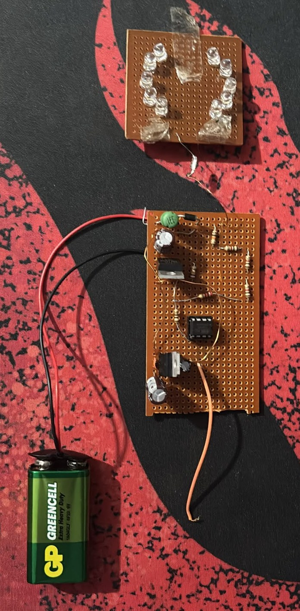

# Feedback-Controlled Boost Converter

A DC-DC boost converter that steps a 9 V battery up to about 30 V, with the output voltage regulated by an ATtiny85. The microcontroller measures the output through a resistor divider and adjusts the PWM duty cycle of the switch. The power stage was first simulated in LTspice, then built on perfboard.



*The converter board (bottom), the LED load board (top) and the 9 V battery.*

## Overview

| Item | Value |
|---|---|
| Topology | Non-isolated boost, continuous conduction |
| Input | 9 V battery |
| Output | about 30 V measured on the prototype |
| Controller | ATtiny85, 8 MHz internal oscillator |
| Feedback | Resistor divider into the 10-bit ADC, duty cycle stepped up or down |
| Switching frequency | 31.25 kHz in hardware, 50 kHz in the simulation |
| Load | 220 Ω in the simulation, a board of ten white LEDs on the prototype |

## How it works

```
9 V ──[ L ]──┬──[ D ]──┬───────┬── Vout
             │         │       │
          [MOSFET]    [C]   [divider] ──> ATtiny85 ADC (A3)
             │         │       │
GND ─────────┴─────────┴───────┴──
             ▲
             └── PWM from ATtiny85 (PB1)
```

While the MOSFET is on, the inductor current ramps up from the input. When it turns off, the inductor pushes that current through the diode into the output capacitor at a voltage above the input. The ratio is set by the duty cycle D: ideally `Vout = Vin / (1 − D)`.

The ATtiny85 closes the loop. It reads the divided output voltage, compares it with a set point, and raises or lowers the duty cycle by one step at a time until they match.

## Power stage and simulation

`simulation/boost_open_loop.asc` is the LTspice model of the power stage, driven at a fixed duty cycle (open loop).

| Part | Value in the simulation |
|---|---|
| Input | 9 V |
| Inductor | 660 µH |
| Switch | IRL3915 logic-level N-channel MOSFET, 5 V gate drive |
| Diode | SS3P5 Schottky |
| Output capacitor | 470 µF |
| Load | 220 Ω |
| Gate signal | 50 kHz, 14.8 µs on-time, D = 0.74 |

Design values calculated from these parts:

| Quantity | Formula | Result |
|---|---|---|
| Ideal output voltage | Vin / (1 − D) | 34.6 V |
| Load current | Vout / R | 157 mA |
| Output power | Vout · Iout | 5.4 W |
| Average inductor current | Iout / (1 − D) | 0.61 A |
| Inductor current ripple | Vin · D / (L · fs) | 0.20 A peak to peak |
| Output voltage ripple | Iout · D / (C · fs) | 5 mV peak to peak |

The inductor ripple is well below twice the average current, so the converter stays in continuous conduction at this load. The MOSFET is rated for 55 V and the diode for 50 V, both above the output voltage.

To run it, open the file in LTspice and start the transient analysis (150 ms). Plot the voltage across the load resistor R1 and the inductor current `I(L1)`.

## Controller

`firmware/boost_controller/boost_controller.ino`, written for the ATtiny85 with the Arduino core.

| Pin | Function |
|---|---|
| PB1 (pin 6) | PWM output to the MOSFET gate |
| PB3 / A3 (pin 2) | Feedback input from the divider |

**PWM.** Timer0 runs in fast PWM mode without a prescaler, which gives 8 MHz / 256 = 31.25 kHz with 8-bit duty resolution.

**Feedback.** The divider is 2.2 kΩ over 12 kΩ + 1 kΩ + 2.2 kΩ, a ratio of 0.1447, so 34.5 V at the output is about 5 V at the pin. The set point is an ADC value of 1020 out of 1023, which corresponds to about 34.4 V with a 5.0 V ADC reference.

**Control law.** If the reading is below the set point, the duty value is increased by one step (1/256) and the output is measured again; if it is above, the duty value is decreased by one step. The loop repeats continuously. Starting from zero duty, this also brings the output up gradually at power-on.

## Result

On the prototype the output measured about 30 V from the 9 V battery with the LED board as load.

This is lower than both the ideal figure for D = 0.74 (34.6 V) and the set point in the code (34.4 V with a 5.0 V reference). The ideal formula ignores losses in the inductor, switch and diode, and the ADC reference is the ATtiny's supply rail, so the real set point moves with the supply voltage.

## Limitations and next steps

- **Set point at the top of the ADC range.** A target of 1020 out of 1023 leaves no headroom to measure an overshoot. Using the internal voltage reference with a rescaled divider would fix this and make the set point independent of the supply.
- **Coarse duty steps.** With 8-bit PWM, one duty step changes the output by roughly 0.4 to 0.5 V near the operating point, so the output moves between adjacent steps instead of settling.
- **Simple control law.** Stepping by one count per measurement responds slowly to load changes. A PI controller running at a fixed sample rate is the natural next step.
- **Simulation scope.** The LTspice model covers the open-loop power stage at 50 kHz with a resistive load. It does not include the control loop, the 31.25 kHz hardware frequency or the LED load.

## Repository layout

```
simulation/boost_open_loop.asc             LTspice model of the power stage
firmware/boost_controller/                 ATtiny85 control firmware
docs/                                      photo of the prototype
```
